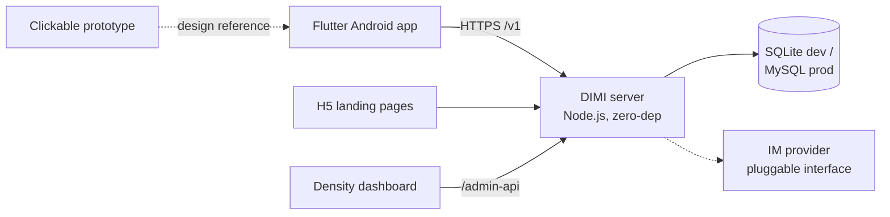

# DIMI · 围城

**Reconnect with old classmates and hometown friends — without giving up your real-name privacy.**

DIMI (围城, after Qian Zhongshu's novel) is a nostalgia-first social app for the Chinese market: it helps you find the people who shared an *anchor* with you — the same school + graduation year, or the same township — while keeping real names masked until mutual trust is established. 中文介绍见 [README.zh.md](README.zh.md)。

This repository contains the product design, the API contract, a clickable prototype, and the working V0.9 vertical slice (Node.js backend + Flutter Android app + H5 landing pages + an operations dashboard).

## Live demo — no install required

| Demo | Link |
|---|---|
| Clickable prototype (16 screens) | https://ellisonyang86.github.io/dimi/prototype/ |
| Recruitment landing page (H5) | https://ellisonyang86.github.io/dimi/h5/ |
| Hometown co-build page (H5) | https://ellisonyang86.github.io/dimi/h5/hometown/ |
| Android preview APK | [Releases](../../releases) |
| Backend quickstart | `cd server && npm run seed && npm start` (Node.js ≥ 22, zero npm dependencies) |

## The problem

Everyone in China has "lost" people: elementary-school classmates whose names they remember, fellow villagers who moved away. Existing tools fail them:

- **WeChat** is a real-name, QR-code social graph — you can only add people you already found;
- **Alumni platforms** (Chinaren, QQ alumni) are dead, spam-ridden, or expose your full identity to strangers;
- People *want* to be found by old friends, but are afraid of exposing their real name, employer and life to strangers, scammers and data brokers.

## How DIMI is different

1. **Anchor-gated search.** You can only search within an anchor — a `school + graduation year` pair or a township. No anchor, no search (`40001`). Deep pagination triggers a slider CAPTCHA (`42901`). This makes mass scraping structurally hard and keeps the product a "walled city": small, dense, safe units.
2. **Gradual real-name reveal (真名渐显).** The server returns your real name — full / masked / nothing — computed from intersection strength (T0–T3) × the other person's privacy setting. Clients are not allowed to second-guess it. Public surfaces (e.g. the recruitment avatar wall) always show masked names.
3. **Tiered verification.** V0 self-declared → V1 mutual confirmation (≥3 classmates auto-promote) → V2 evidence → V3 organization. Unverified profiles carry an explicit disclaimer.
4. **Density engineering.** Social products die from empty rooms. DIMI's unit of growth is the *anchor cell*; the operations dashboard (`admin/`) measures cell density (registered / roster) and drives "recruitment orders" (召集令) — H5 posters that seed one classroom at a time.
5. **A configurable privacy decision engine.** Visibility rules live in `server/src/engine/rules.json`; every decision writes an audit snapshot. Privacy is enforced server-side, in one auditable place — not scattered across clients.
6. **Safety by design.** Under-14 registration rejected; 14–18 not admitted in V0.9. Reporting, blacklists and device management are built in.

## Architecture



| Directory | What it is |
|---|---|
| `server/` | Backend: HTTP router, auth, privacy engine, IM provider, janitor. Zero npm runtime deps; 55 end-to-end/rule tests (`npm test`). |
| `app/` | Flutter Android client (screens, state, theme, widgets). Passes `flutter analyze` with 0 errors; debug APK builds. |
| `h5/` | Static growth pages: recruitment landing + hometown co-build. |
| `admin/` | Cell-density operations dashboard. |
| `prototype/` | 16-screen clickable product prototype (pure HTML). |
| `database/` | MySQL schema deltas (V3.0 data model). |
| `DIMI_OpenAPI.yaml` | API contract v3.1.0 — 93 endpoints, single source of truth. |

## Quickstart

```bash
# Backend — seed demo data and start (default :8080)
cd server
npm run seed     # demo class: 城关镇第二小学 1996级 六年2班 (10 users + 35-name dormant roster)
npm start

# Verify
npm test         # 55 end-to-end / rule tests

# Pages
#   Recruitment landing:  http://localhost:8080/h5/?code=CG2X96
#   Density dashboard:    http://localhost:8080/admin/  (dev token only)

# Flutter app (requires Flutter SDK ≥ 3.10)
cd app && flutter pub get && flutter run
```

## Design red lines (enforced in code)

- No anchor → search rejected (`40001`); paginating past page 3 → slider CAPTCHA (`42901 need_captcha`).
- `real_name` is returned only as computed by the server (full / masked / null); clients must not re-process it; public scenes always mask.
- Verification tiers V0–V3; V0 profiles carry an "unverified" qualifier.
- Minors: <14 rejected; 14–18 not admitted (V0.9).
- Dev mode: SMS codes are returned in responses (`[DEV-SMS]` log tag) and must be removed before production.

## Roadmap

- **V0.9 — vertical slice (this repo, done):** accounts, anchor search, friend graph, privacy engine, moments, chat (text/image/voice/video), hometown pages, long-form reading, wallet scaffolding, H5 growth loop, ops dashboard.
- **V1.0 — production hardening:** swap the built-in IM provider for Tencent Cloud IM / RongCloud (interface is ready in `server/src/im/provider.js`), real SMS gateway + CAPTCHA, MySQL migration, app-store compliance pack (ICP, 等保, algorithm filing, software copyright — drafts in progress).
- **Beyond:** hometown co-build system, class groups, gifting/virtual goods (RMB-denominated platform credits, fully compliant), local services.

## Known limitations (as of V0.9)

- The Flutter app is verified via `flutter analyze` (0 errors) and debug APK builds, but has not been through on-device QA.
- IM is a minimal local implementation behind a provider interface; production uses a commercial IM SDK.

## Documents

| Document | Content |
|---|---|
| `DIMI围城_社交APP设计报告.md` | Product design report V2.1 (main document) |
| `DIMI围城_深度洞察与差异化升级方案_V3.md` | Strategy & differentiation V3.0 |
| `DIMI围城_V0.9开发计划书.md` | V0.9 planning: scope, schedule, budget, acceptance |
| `DIMI_OpenAPI.yaml` | API contract v3.1.0 (93 endpoints) |

## License & trademark

Code is released under the [MIT License](LICENSE). The names **DIMI** and **围城** and the product branding are trademarks reserved by the project owner and are not covered by the MIT License.

[中文介绍](README.zh.md)
