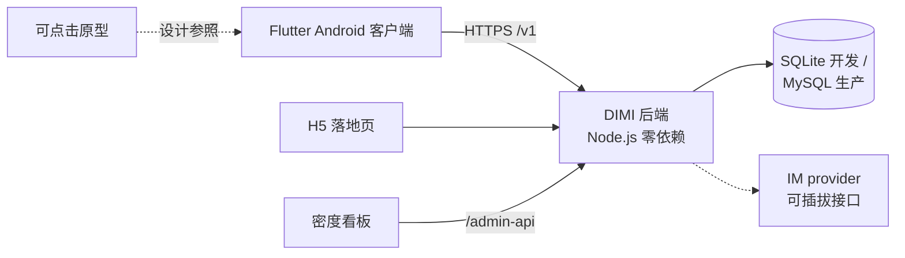

# DIMI · 围城

**找回老同学、老乡的怀旧社交应用——不必拿真名隐私做交换。**

DIMI（围城，取自钱锺书小说）是一款面向中国市场的怀旧社交产品：以"锚点"（某学校某届、某乡镇）为单元，帮你找回有共同经历的人，同时用"真名渐显"机制保护隐私——在交集被验证之前，陌生人看到的永远是掩码名字。English version: [README.md](README.md)。

本仓库包含产品设计文档、API 契约、可点击原型，以及可运行的 V0.9 垂直切片（Node.js 后端 + Flutter Android 客户端 + H5 落地页 + 运营看板）。

## 在线体验（无需安装）

| 演示 | 链接 |
|---|---|
| 可点击原型（16 屏） | https://ellisonyang86.github.io/dimi/prototype/ |
| 召集令落地页 | https://ellisonyang86.github.io/dimi/h5/ |
| 家乡共建页 | https://ellisonyang86.github.io/dimi/h5/hometown/ |
| Android 体验包 | [Releases](../../releases) |
| 后端快速启动 | `cd server && npm run seed && npm start`（Node.js ≥ 22，运行时零依赖） |

## 解决什么问题

几乎每个人都有"丢了的人"：记得名字的小学同学、搬走了的老乡。现有工具都不行：

- **微信**是实名二维码社交图，只能加"已经找到的人"；
- **校友录类产品**（Chinaren、QQ 校友）早已死亡或充斥广告，还把真实身份完全暴露给陌生人；
- 人们**想**被老朋友找到，但害怕把真名、单位、生活暴露给陌生人、骗子、数据黑产。

## 差异化设计

1. **锚点强制**：没有"学校+届"或镇级地区锚点就不能检索（`40001`）；翻页超过 3 页触发滑块验证（`42901`）。大规模爬取在结构上被杜绝，产品以"小而密的单元"运转。
2. **真名渐显**：`real_name` 由服务端按交集强度（T0–T3）× 对方三档隐私设置计算后返回（全名/掩码/null），客户端不得二次加工；公开场景（如召集令头像墙）一律掩码。
3. **验证分级**：V0 自述 → V1 同窗互证（≥3 同班好友自动升级）→ V2 证据 → V3 组织；V0 档案带"未验证"限定句。
4. **密度工程**：社交产品死于空房间。DIMI 的增长单元是"锚点单元格"；运营看板（`admin/`）度量单元密度（已注册/名册总数），用"召集令"H5 海报一次引爆一个班级。
5. **隐私决策引擎配置化**：可见性规则集中在 `server/src/engine/rules.json`，每次判定写入审计快照——隐私由服务端单点、可审计地执行。
6. **安全红线**：<14 周岁拒绝注册，14–18 暂不放行（V0.9）；内置举报、黑名单、设备管理。

## 架构



## 快速开始

```bash
# 后端：初始化种子数据并启动（默认 :8080）
cd server
npm run seed     # 演示班级：城关镇第二小学 1996级 六年2班（10 用户 + 35 人沉睡名册）
npm start

# 验证
npm test         # 55 组端到端/规则测试

# Flutter 客户端（需 Flutter SDK ≥ 3.10）
cd app && flutter pub get && flutter run
```

## 已知未验证项（V0.9）

- Flutter 端已通过 `flutter analyze`（0 错误）与 debug APK 构建验证，未做真机走查；
- IM 为本地极简实现（`server/src/im/provider.js` 接口层），正式版按 V0.9 计划书 §5.3 替换腾讯云 IM / 融云 SDK。

## 文档

| 文档 | 内容 |
|---|---|
| `DIMI围城_社交APP设计报告.md` | 设计报告 V2.1（主文档） |
| `DIMI围城_深度洞察与差异化升级方案_V3.md` | 战略升级 V3.0 |
| `DIMI围城_V0.9开发计划书.md` | 开发立项依据（范围/排期/预算/验收） |
| `DIMI_OpenAPI.yaml` | API 契约 v3.1.0（93 接口，单一事实源） |

## 许可证与商标

代码基于 [MIT 许可证](LICENSE) 发布。**DIMI** 与**围城**名称及产品标识为项目方保留的商标，不在 MIT 许可范围内。

[English](README.md)
